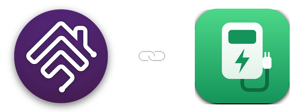

   

## homebridge-openeo

Homebridge plugin to show EO Mini Pro 2 and EO Smart Home Hub chargers running OpenEO in Apple Home

 

### Plugin Information

- This plugin shows an EO Mini Pro 2 or EO Smart Home Hub EV charger in Apple Home, when the charger runs [OpenEO](https://github.com/minceheid/openeo) - open-source software that replaces EO's own app, which is no longer available. The plugin:
  - talks to the charger on your home network - no account or cloud needed
  - finds the charger on the network by itself
  - shows a **charge now** on/off tile, a **Car Connected** sensor and a **Charging Schedule** switch
  - shows a **Charger Problem** sensor, which alerts you if the charger reports a fault or goes offline
  - can show **live watts and kWh** in the Home app, over Matter (Homebridge `v2.2` or above)
  - adds a status page with recent charging sessions to the plugin's settings page
- It doesn't work with EO's original software, or with the EO Mini Pro 3.

### Prerequisites

- To use this plugin, you will need to already have:
  - [Node](https://nodejs.org): latest version of `v22`, `v24` or `v26` - any other major version is not supported.
  - [Homebridge](https://homebridge.io): `v1.11.4` or above, or `v2` - refer to link for more information and installation instructions.
  - An EO Mini Pro 2 or EO Smart Home Hub running [OpenEO](https://github.com/minceheid/openeo).
  - For live watts in the Home app: Homebridge `v2.2` or above with Matter turned on, and iOS `27` or above.

### Setup

- [Installation](https://github.com/homebridge-plugins/homebridge-openeo/wiki/Installation)
- [Configuration](https://github.com/homebridge-plugins/homebridge-openeo/wiki/Configuration)
- [Beta Version](https://github.com/homebridge-plugins/homebridge-openeo/wiki/Beta-Version)
- [Node Version](https://github.com/homebridge-plugins/homebridge-openeo/wiki/Node-Version)

### Features

- [Supported Chargers](https://github.com/homebridge-plugins/homebridge-openeo/wiki/Supported-Chargers)
- [Energy and Matter](https://github.com/homebridge-plugins/homebridge-openeo/wiki/Energy-and-Matter)
- [Status Page](https://github.com/homebridge-plugins/homebridge-openeo/wiki/Status-Page)

### Help/About

- [Common Errors](https://github.com/homebridge-plugins/homebridge-openeo/wiki/Common-Errors)
- [Support Request](https://github.com/homebridge-plugins/homebridge-openeo/issues/new/choose)
- [Changelog](https://github.com/homebridge-plugins/homebridge-openeo/blob/latest/CHANGELOG.md)

### Credits

- To [@Wazza151](https://github.com/Wazza151): the creator of this plugin.
- To the creators/contributors of [OpenEO](https://github.com/minceheid/openeo), which this plugin talks to.
- To the creators/contributors of [Homebridge](https://homebridge.io) who make this plugin possible.

### Disclaimer

- I am in no way affiliated with EO Charging or the OpenEO project and this plugin is a personal project that I maintain in my free time.
- Use this plugin entirely at your own risk - please see licence for more information.
